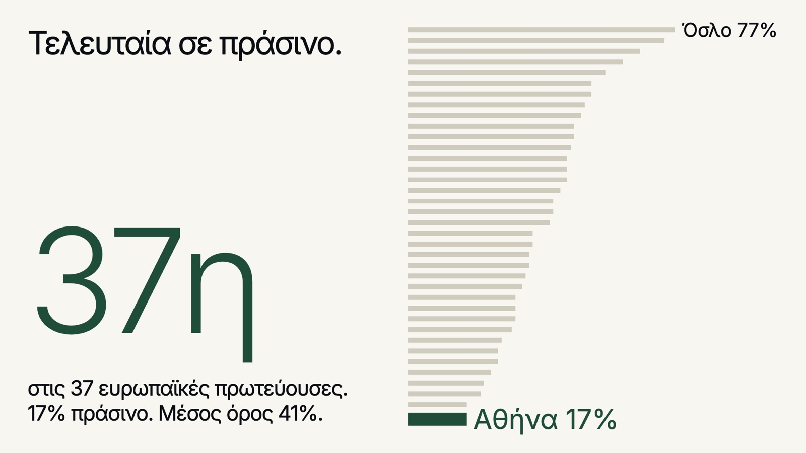
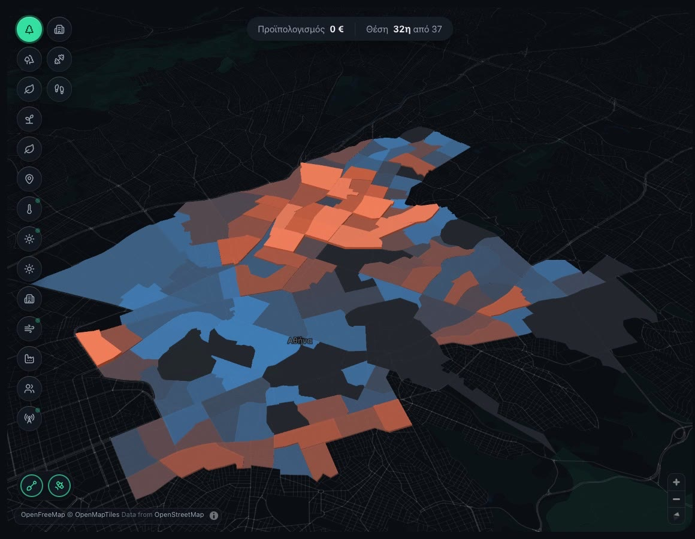
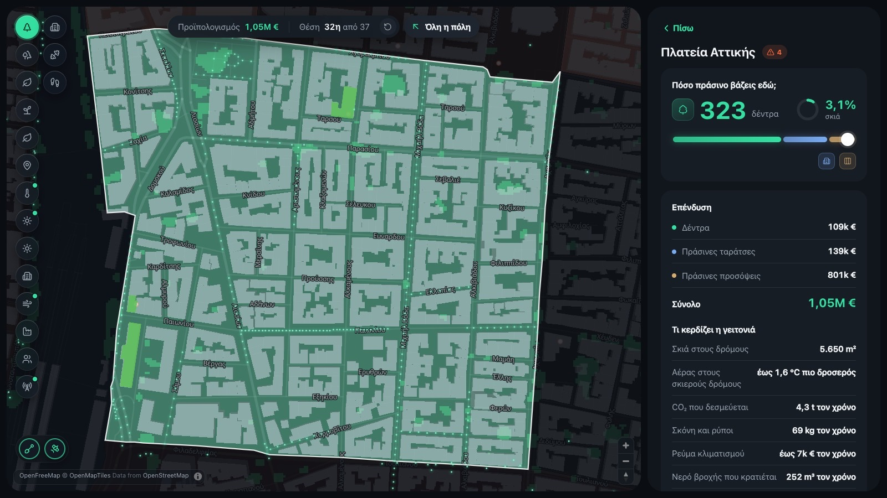
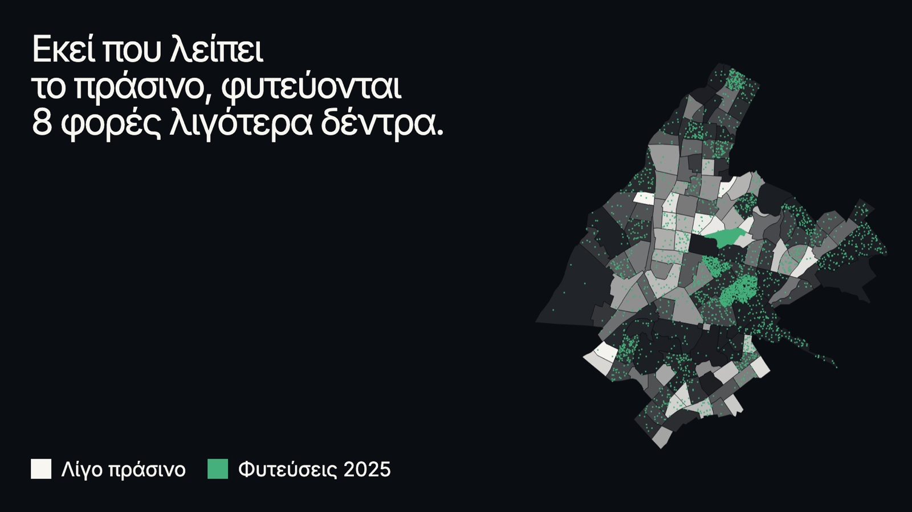

<p align="center">
  <a href="https://dataexplora.com/pnyka"></a>
</p>

<h1 align="center">Pnyka</h1>

<p align="center"><b>Ο χάρτης του πρασίνου της Αθήνας.</b><br>by TR2, Apps4Athens 3.0</p>

<p align="center">
  <a href="https://athens.dataexplora.com"><b>Εφαρμογή</b></a>
  &nbsp;&nbsp;|&nbsp;&nbsp;
  <a href="https://dataexplora.com/pnyka"><b>Το Pnyka</b></a>
  &nbsp;&nbsp;|&nbsp;&nbsp;
  <a href="https://dataexplora.com"><b>Data Explora</b></a>
</p>

---

## Το πρόβλημα



Η Αθήνα είναι **τελευταία σε πράσινο ανάμεσα σε 37 ευρωπαϊκές πρωτεύουσες**: πράσινο στο 17% της πόλης, με μέσο όρο 41%. Στις γειτονιές με το λιγότερο πράσινο φυτεύονται 8 φορές λιγότερα δέντρα.


## Η λύση

**Το Pnyka δείχνει στον Δήμο, γειτονιά προς γειτονιά, πού μπορεί να αυξηθεί το πράσινο, πόσο κοστίζει και τι κερδίζουν οι κάτοικοι.**



| | |
|---|---|
| **Ανάγκη** | Οι 144 γειτονιές της Αθήνας στον χάρτη, σε κατάταξη ανάλογα με την έλλειψη πρασίνου και τον πληθυσμό τους. |
| **Δυνατότητα** | 55.050 καταγεγραμμένες θέσεις για νέα δέντρα σε πεζοδρόμια, πεζόδρομους και σχολικές αυλές, και τα δημοτικά κτίρια όπου μπορούν να γίνουν πράσινες ταράτσες και προσόψεις. |
| **Σχεδιασμός** | Ο χρήστης επιλέγει γειτονιά και ορίζει πόσα δέντρα, πράσινες ταράτσες και προσόψεις θα γίνουν. Η παρέμβαση εμφανίζεται αμέσως στις πραγματικές θέσεις. |
| **Κόστος** | Επένδυση ανά είδος παρέμβασης και συνολικός προϋπολογισμός για όλη την πόλη. |
| **Όφελος** | Σκιά, θερμοκρασία, CO₂, ρύποι, ενέργεια και νερό βροχής για τους κατοίκους κάθε γειτονιάς. |



<p align="center"><i>Πλατεία Αττικής: 323 δέντρα, πράσινες ταράτσες και προσόψεις, με την επένδυση και το όφελος για 6.800 κατοίκους.</i></p>

## Πριν και μετά την παρέμβαση

<table>
<tr>
<td width="50%"></td>
<td width="50%"></td>
</tr>
</table>

## Δεδομένα και τεχνολογία

| Πηγή | Τι δίνει |
|---|---|
| [Ανοιχτά δεδομένα Δήμου Αθηναίων](https://opendata.cityofathens.gr) | Αισθητήρες θερμοκρασίας και ποιότητας αέρα |
| [GIS Δήμου Αθηναίων](http://gis.cityofathens.gr) | Γειτονιές, δημοτικά κτίρια, ηλιακός χάρτης |
| [Athens Trees](https://athenstrees.cityofathens.gr) | Φυτεύσεις του Δήμου 2024-26 |
| [Copernicus Urban Atlas](https://land.copernicus.eu/en/products/urban-atlas/street-tree-layer-stl-2021) | Κάλυψη δέντρων ανά δρόμο, από δορυφόρο |
| Ευρωπαϊκός Οργανισμός Περιβάλλοντος | Σύγκριση 37 πρωτευουσών |
| OpenStreetMap, OpenFreeMap | Δρόμοι, πεζοδρόμια, υπόβαθρο χάρτη |

**Εφαρμογή:** Vite, React, TypeScript, MapLibre. **Ανάλυση:** Python. Όλη η ανάλυση είναι ανοιχτή σε αυτό το αποθετήριο και αναπαράγεται με τα scripts.



## Εγκατάσταση και εκτέλεση

```bash
cd app
npm install
npm run dev      # τοπικά
npm run build    # παραγωγή, στον φάκελο app/dist
```

## Δομή του αποθετηρίου

| Φάκελος | Περιεχόμενο |
|---|---|
| `app/` | Η εφαρμογή |
| `engine/` | Κατάταξη γειτονιών και υπολογισμός προϋπολογισμού, με tests |
| `planting/` | Υποψήφιες θέσεις για νέα δέντρα σε πεζοδρόμια, πεζόδρομους και σχολικές αυλές |
| `greenroofs/`, `roofs/` | Δημοτικά κτίρια, ταράτσες και προσόψεις |
| `streets/`, `treecover/`, `athenstrees/`, `capacity/`, `species/`, `analysis/` | Αναλύσεις ανά θέμα |
| `scripts/` | Λήψη και επεξεργασία των ανοιχτών δεδομένων |
| `neighbourhoods.geojson`, `neighbourhoods.csv`, `stations.csv`, `DATA.md` | Το σύνολο δεδομένων ανά γειτονιά |
| `mockup/`, `brand/` | Σχέδια οθονών και ταυτότητα |

## Άδειες και πηγές δεδομένων

Ο κώδικας διατίθεται με άδεια [MIT](LICENSE).

Τα δεδομένα προέρχονται από ανοιχτές πηγές, και η χρήση τους ακολουθεί τους όρους κάθε πηγής:

- Ανοιχτά δεδομένα και GIS του Δήμου Αθηναίων, Athens Trees.
- Copernicus Land Monitoring Service, Urban Atlas (περιέχει τροποποιημένα δεδομένα Copernicus).
- Ευρωπαϊκός Οργανισμός Περιβάλλοντος.
- © Συντελεστές του OpenStreetMap (ODbL). Υπόβαθρο χάρτη: OpenFreeMap, OpenMapTiles.
- Meta και World Resources Institute, High Resolution Canopy Height (CC BY 4.0).

Τα ακατέργαστα αρχεία των πηγών δεν περιλαμβάνονται. Τα scripts στον φάκελο `scripts/` τα κατεβάζουν ξανά.

## Επόμενα βήματα

- **Σύνδεση με βοηθούς τεχνητής νοημοσύνης.** Ο χρήστης ρωτά σε φυσική γλώσσα, για παράδειγμα «Με ένα εκατομμύριο ευρώ, σε ποιες γειτονιές φυτεύουμε πρώτα;», και η απάντηση βγαίνει από τα δεδομένα του Pnyka.
- **Αυτόματη σύνταξη εισήγησης.** Από το σχέδιο που ορίζεται στον χάρτη παράγεται έγγραφο για το Δημοτικό Συμβούλιο, με κόστος, οφέλη και γραφήματα.
- **Ενιαίο μητρώο δέντρων.** Καταγραφή κάθε δέντρου με τη θέση και το είδος του, ώστε να είναι γνωστά το περιβαλλοντικό του όφελος, οι ανάγκες του και το κόστος συντήρησής του.
- **Επέκταση σε άλλους δήμους.** Η ίδια μέθοδος εφαρμόζεται με τα δεδομένα κάθε πόλης.

---

<p align="center">
  <a href="https://dataexplora.com/pnyka"><b>dataexplora.com/pnyka</b></a><br>
  Pnyka, by TR2 (<a href="https://dataexplora.com">Data Explora</a>)
</p>
